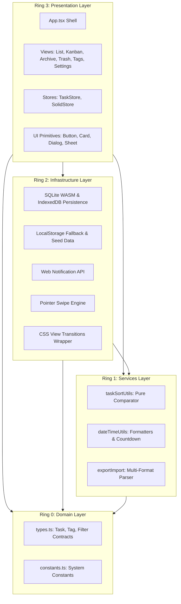
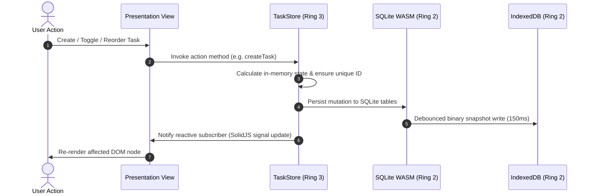

# Architecture Specification: ToDayLy

<!-- @gov:ARCH-OVERVIEW -->
## 1. High-Level Architectural Overview

ToDayLy is a local-first reactive task management Single Page Application engineered with SolidJS, Panda CSS, and SQLite WASM. The application enforces a strict 4-Ring Clean Architecture based on the Functional Core, Imperative Shell (FC/IS) paradigm:



<!-- @gov:ARCH-TOPOLOGY -->
## 2. Physical Directory Topology

```text
todayly/
├── src/
│   ├── domain/               # Ring 0: Pure entities, types, and constants (Zero DOM, zero framework)
│   │   ├── types.ts          # Core data models: Task, Tag, SortOption, ViewMode, ActiveTab
│   │   ├── constants.ts      # Immutable application metadata
│   │   └── index.ts          # Domain barrel exports
│   ├── services/             # Ring 1: Headless computational engines (Tested via bun:test)
│   │   ├── taskSortUtils.ts  # Pure O(N log N) sorting and text query filter
│   │   ├── dateTimeUtils.ts  # Date formatters and deadline countdown calculations
│   │   ├── exportImport.ts   # Multi-format serialization (JSON, YAML, CSV)
│   │   └── index.ts          # Services barrel exports
│   ├── infrastructure/       # Ring 2: Browser APIs and storage persistence
│   │   ├── sqliteStorage.ts  # SQLite WASM engine backed by IndexedDB binary snapshot
│   │   ├── storage.ts        # LocalStorage fallback and starter seed definitions
│   │   ├── notification.ts   # Native Web Notification API dispatcher
│   │   ├── gestures.ts       # GPU-accelerated touch and mouse swipe coordinator
│   │   ├── viewTransition.ts # Document View Transitions API wrapper
│   │   └── index.ts          # Infrastructure barrel exports
│   ├── presentation/         # Ring 3: Reactive SolidJS views and presentation adapters
│   │   ├── App.tsx           # Root presentation shell and view switcher
│   │   ├── stores/           # Unidirectional task store and SolidJS reactive adapter
│   │   ├── components/       # Reusable UI primitives, view components, and bottom sheets
│   │   └── utils/            # Presentation styling utilities (cn)
│   ├── index.css             # Base styles, Panda CSS layers, and spring physics keyframes
│   └── main.tsx              # Application bootstrap entrypoint
├── tests/
│   └── services.test.ts      # Headless unit verification suite (bun:test)
├── docs/
│   ├── PRD.md                # ISO 29148 requirements specification
│   ├── TDD.md                # Technical design document and architecture contracts
│   ├── schema.dbml           # Database schema definition (DBML)
│   └── adr/                  # Architecture Decision Records (0001, 0002)
├── tokens/
│   └── main.tokens.kdl       # DUDUNG KDL design tokens specification
├── panda.config.ts           # Compile-time Panda CSS configuration
├── tsconfig.json             # Strictest TypeScript compiler configuration
└── vite.config.ts            # Vite 8 build pipeline configuration
```

<!-- @gov:ARCH-BINDING -->
## 3. Formal Specification Alignment

- **Requirements Grammar (`docs/PRD.md`):** All 7 functional requirements (`FR-TASK-01` through `FR-THEME-01`) adhere to ISO/IEC/IEEE 29148.
- **Technical Design (`docs/TDD.md`):** Component recipes, storage contracts, and micro-benchmark matrices.
- **Relational Storage Model (`docs/schema.dbml`):** Relational 3NF tables with `tasks`, `tags`, and `task_tags` junction table.
- **Design Tokens (`tokens/main.tokens.kdl`):** Material 3 semantic color mapping and layout dimensions with explicit units.

<!-- @gov:ARCH-LIFELINE -->
## 4. Cross-Module Data Flow Lifeline



<!-- @gov:ARCH-INVARIANTS -->
## 5. Architectural Boundary Invariants

1. **Unidirectional Dependency Invariant:**
   Ring 0 (`domain/`) must never import from outer rings. Ring 1 (`services/`) may only import from Ring 0. Ring 2 (`infrastructure/`) may import from Rings 0 and 1. Ring 3 (`presentation/`) may consume all inner rings.
2. **Headless Execution Invariant:**
   All modules in `src/services/` must execute headlessly in native Bun tests (`bun test`) with zero DOM dependencies or JSDOM mocks.
3. **Flat Control Flow Invariant:**
   The codebase strictly enforces early returns and guard clauses. Zero `else` blocks and zero nested `if` statements are permitted.
4. **Local-First Zero Telemetry Invariant:**
   All user task and tag records remain exclusively on the local client device via SQLite WASM and IndexedDB. Zero cloud telemetry or external network calls are executed.
