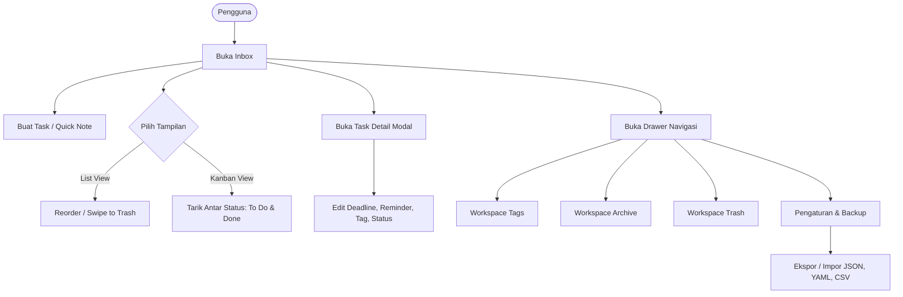

# Product Requirement Document (PRD) – ToDayLy
- **Nama Produk:** ToDayLy (Simple & Powerful Task Manager)
- **Versi Rilis:** v1.0.0
- **Tingkat Skala:** Tier 1 (Client-Side Reactive SPA / Embedded LocalStorage)
- **Status Dokumen:** Approved

---

## 1. Ringkasan Eksekutif & Latar Belakang
ToDayLy adalah aplikasi manajemen tugas (*task manager*) harian berperforma tinggi yang dibangun di atas SolidJS. Aplikasi ini dirancang untuk mengatasi friksi produktivitas dengan antarmuka Material 3, dukungan gestur alami, persistensi lokal tanpa pelacakan (*zero-telemetry*), sistem pengingat dan batas waktu (*deadline & reminder*), serta interoperabilitas data multi-format (JSON, YAML, CSV).

## 2. Diagram Konseptual Alur Bisnis (Mermaid Makro)

## 3. Kebutuhan Fungsional (Functional Requirements)

<!-- [@req:FR-TASK-01:MUST] [@criticality:high] -->
### FR-TASK-01: Manajemen Tugas Inti (CRUD & Reorder)
- **Deskripsi Fitur:** Pengguna dapat membuat, melihat, memperbarui, menduplikasi, memindahkan ke trash, menghapus permanen, dan mengurutkan ulang (*reorder*) tugas.
- **Invarian Matematis:**
  $$
  \forall t_1, t_2 \in \text{Tasks}, \quad t_1.id \ne t_2.id \land \text{order}(t) \in [0, N-1]
  $$
- **Happy Path:**
  1. Pengguna membuka modal pembuatan tugas.
  2. Memasukkan judul tugas wajib beserta atribut opsional (deskripsi, deadline, reminder, tag).
  3. Tugas tersimpan di *inbox* dengan ID unik numerik berbasis timestamp.

<!-- [@req:FR-TASK-02:MUST] [@criticality:high] -->
### FR-TASK-02: Penyaringan & Pengurutan Tugas (Filtering & Sorting)
- **Deskripsi Fitur:** Mendukung pencarian teks instan (judul & deskripsi) dan 10 mode pengurutan: kustom/manual, alfabetik (A-Z, Z-A), status (selesai dahulu), tenggat waktu (terdekat, terjauh), pengingat (terdekat, terjauh), serta waktu pembuatan (terbaru, terlama).

<!-- [@req:FR-TASK-03:MUST] [@criticality:high] -->
### FR-TASK-03: Workspace Dualitas Tampilan (List & Kanban Board)
- **Deskripsi Fitur:** Menyediakan peralihan mulus antara Tampilan Daftar (*List View*) dan Papan Kanban 2 Kolom (*To Do* vs *Completed*) dengan animasi View Transitions tanpa *layout shift*.

<!-- [@req:FR-TAG-01:MUST] [@criticality:low] -->
### FR-TAG-01: Manajemen Tag Warna (Kategori Tugas)
- **Deskripsi Fitur:** Pembuatan, pengeditan, pewarnaan kustom (*hex preset*), dan penghapusan tag dengan kaskade penghapusan tag referensi pada seluruh tugas aktif, arsip, dan tempat sampah.

<!-- [@req:FR-IO-01:MUST] [@criticality:high] -->
### FR-IO-01: Interoperabilitas Backup Multi-Format (JSON, YAML, CSV)
- **Deskripsi Fitur:** Ekspor seluruh daftar tugas ke berkas atau *clipboard* dalam format JSON, YAML, atau CSV, serta impor dengan validasi sintaks dan strategi *Append* atau *Replace*.

<!-- [@req:FR-NOTIF-01:MUST] [@criticality:high] -->
### FR-NOTIF-01: Peringatan Tenggat Waktu & Pengingat (Native Web Notifications)
- **Deskripsi Fitur:** Evaluasi berkala setiap 30 detik untuk mendeteksi tugas belum selesai yang melewati batas waktu dan memicu notifikasi desktop peramban native.

<!-- [@req:FR-THEME-01:MUST] [@criticality:low] -->
### FR-THEME-01: Sistem Tema & Desain Token Material 3 (Panda CSS)
- **Deskripsi Fitur:** Dukungan tema Terang (*Light*) dan Gelap (*Dark*) dengan kontras tinggi yang terikat ke sistem desain token DUDUNG dan dikompilasi secara *type-safe* menggunakan Panda CSS.

## 4. Batasan Sistem & Negative Scope

### Batasan Sistem (System Limits)
| ID | Parameter | Nilai Batas | Prioritas |
|---|---|---:|---|
| LIM-01 | Panjang Judul Tugas | 256 karakter | MUST |
| LIM-02 | Panjang Deskripsi Tugas | 4096 karakter | MUST |
| LIM-03 | Maksimal Tag per Tugas | 12 tag | SHOULD |
| LIM-04 | Interval Evaluasi Notifikasi | 30 detik | MUST |
| LIM-05 | Ukuran File Impor Maksimal | 5 MiB | MUST |

### Negative Scope
- **Tegas TIDAK Dibuat pada Versi Ini:**
  - Sinkronisasi server terpusat/cloud akun backend (aplikasi mempertahankan prinsip privasi *local-first storage*).
  - Integrasi perpesanan sosial/chat bot otomatis.

## 5. Katalog Use Case
Rincian skenario operasional dan pengujian lengkap terdokumentasi pada `docs/USE_CASES.md`.
